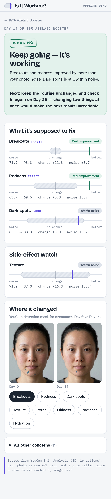

# Is It Working?

**A skincare efficacy tracker that knows how much your photos lie.**

People don't wonder about their skin in the abstract. They wonder at the mirror, three weeks into a new serum: *is this actually doing anything, or did I waste $38?* Before/after selfies can't answer that honestly — light, angle and distance change every day, and AI skin scores move with them. Most apps happily show "+4 points!" anyway.

Is It Working? treats every product as a small experiment. It measures how noisy **your** photos are, and only calls a change real when it is bigger than that noise. When it can't tell yet, it says so.

> **Read this first (honest scope).**
> - Every face in this repo, the screenshots and the demo video is a **synthetic, AI-generated or edited example image** of a fictional person. No real user data.
> - The per-concern **noise prior comes from only 3 same-day retake pairs of synthetic images** (`lib/noise_prior.json`, `pairs: 3`). It is a starting guess, not a calibrated population estimate. On a real user the Day 0 pair is pooled with it, and with real users it should be re-calibrated.
> - The sample "retake" photos are re-crops / exposure shifts of one generated image, not two separate camera shots. The retinol "irritation" case is a **constructed scenario** (a Skin-Simulation-cleared baseline compared with the original face).
> - The recorded demo replays **cached YouCam API responses** (the screens say "OFFLINE DEMO"). Live calls need your own key.
> - Not a medical device, not medical advice.



## How it works

1. **Register a product.** Pick the key active (azelaic acid, niacinamide, retinol, …). The app pre-selects the concerns that ingredient targets and its typical time to visible results.
2. **Day 0: two selfies, a minute apart.** Both go through YouCam Skin Analysis (15 concerns + skin type). Your skin didn't change in that minute, so any difference between the two scores is pure photo noise. That gap becomes your personal **noise band**.
3. **Goal preview + detectability check.** YouCam Skin Simulation renders a realistic 50% improvement of the target concerns on your own face. The app then runs Skin Analysis on that simulated image to learn how far the score would move if the product really worked — and tells you whether that change is even detectable by photo, or whether you need two photos per check-in.
4. **Check in on Day 7 / 14 / 28.** An oval guide and a faint Day 0 overlay keep framing consistent. On-device checks compare exposure, light colour and sharpness to Day 0 before anything is uploaded.
5. **Verdict with one next action.**
   - **Keep going — it's working**: a target concern improved by more than the noise band.
   - **Too early to tell**: nothing cleared the band yet, and you're still before the ingredient's typical window.
   - **Stop & patch-test**: breakouts, redness or texture got measurably *worse* — a likely irritation signal.
   - **Probably not working**: past the typical window and still nothing beyond noise.
6. **Where it changed.** YouCam detection masks for Day 0 vs the check-in, per concern.

## YouCam APIs used

| API | Endpoint | Used for |
| --- | --- | --- |
| File API | `POST /s2s/v2.0/file` + PUT to the signed URL | Uploading every photo |
| AI Skin Analysis (SD, 16 actions, `format: json`) | `POST /s2s/v2.0/task/skin-analysis`, `GET /s2s/v2.0/task/skin-analysis/{task_id}` | Scores for 15 concerns + skin type, skin age, detection masks |
| AI Skin Analysis v2.1 (`pf_camera_kit: true`) | `POST /s2s/v2.1/task/skin-analysis` | Photos captured with the guided camera |
| AI Skin Simulation | `POST /s2s/v2.0/task/skin-simulation`, `GET …/{task_id}` | Goal preview, and the expected score change used for the detectability check |
| AI Image Generator V2 | `POST /s2s/v2.0/task/text-to-image/youcam` | Generating a synthetic face for the bundled sample experiments (dev script) |
| JS Camera Kit v2.5 (`faceDetectionMode: 'skincare'`) | browser SDK | Optional guided capture with face size / pose / lighting validation |

Authentication is `Authorization: Bearer <API key>` on the server only. The key is read from the `YOUCAM_API_KEY` environment variable and never reaches the browser. Every task is polled until `success` or `error`; engine errors such as `error_src_face_too_small` or `error_lighting_dark` are translated into plain retake instructions.

Every analysis is cached by a SHA-256 of the exact image bytes and the requested actions (`fixtures/cache/`), including the downloaded masks, so the same photo is never billed twice and the demo runs offline.

## The noise logic

All scores are YouCam `raw_score` values (1–100, higher = healthier). For each concern *c*:

- **Baseline** = mean of the Day 0 shots.
- **Noise σ** = the spread of the Day 0 pair, pooled with a per-concern prior:
  `σ² = (s²_pair · 1 + σ²_prior · 2) / 3`, floor 1.5.
  The prior (`lib/noise_prior.json`, built by `scripts/calibrate_noise.js`) comes from same-day retake pairs we analysed during development. It matters: one lucky pair can look perfectly stable, while in our data pores (σ≈4.8) and texture (σ≈10.7, very sensitive to a head turn) jump far more than redness or breakouts (σ≈1.5).
- **Change** Δ = check-in mean − baseline, with standard error `SE = σ·√(1/n₀ + 1/n₁)`.
- A change is **real** only when `|Δ| ≥ 2·SE` (about 95% for normal noise). Otherwise it is shown inside the hatched band as "within noise".
- **Detectability**: the simulated goal image gives the expected Δ for a visible 50% improvement. If that Δ is below `2·SE` for one photo but above it for two, the app asks for two photos per check-in; if even two aren't enough, it says photos can't settle that concern.

In the bundled samples this is exactly what separates the answers: on Day 7 of a niacinamide serum, pores moved +5.4 points, but that user's band was ±9.6 → **Too early**, instead of a false "it's working!".

## Run it

Requirements: Node 18+.

```bash
npm install
cp .env.example .env        # then put your YouCam API key in YOUCAM_API_KEY
npm start                   # http://localhost:3000
```

On first start the app loads two sample experiments from `fixtures/sample_data/` (set `NO_SAMPLES=1` to start empty).

Without a key the server starts in **offline demo mode**: photos whose analysis is already in `fixtures/cache/` still work (all demo photos are), new photos are rejected with a clear message.

Other scripts:

```bash
npm run e2e                                   # Playwright end-to-end run, writes screenshots/
SEED_FROM=fixtures/sample_data npm run e2e    # same, plus the two sample experiments
node scripts/seed_samples.js http://localhost:3000   # adds the sample experiments to a running app
node scripts/make_demo_video.js               # records the flow and builds demo/is-it-working-demo.mp4
```

## Demo data

All faces in this repository, the screenshots and the demo video are **synthetic, AI-generated images** of fictional people:

- `fixtures/demo_images/day0.jpg`, `day0_retake.jpg`, `day14.jpg` — generated with Genspark (Nano Banana Pro). The retake has warmer light and a slight head turn on purpose.
- `maya_*` and `jun_*` — derived from one face generated with the YouCam AI Image Generator. Same-day retakes and the Day 7 photo are small re-crops and exposure shifts of the same image. The niacinamide Day 14 source and the retinol "clear" baseline were made with YouCam Skin Simulation, so the retinol sample's "irritation" is a constructed scenario (a simulated-clear Day 0 compared to the original face).

## Project layout

```
server.js               Express server, upload pipeline, product/check-in API
lib/youcam.js           YouCam client: File API, task create + polling, caching, unit ledger
lib/verdict.js          Noise model, change detection, verdict and next action
lib/ingredients.js      Concerns, ingredient targets and typical windows
lib/noise_prior.json    Per-concern prior noise
public/                 Single-page app (vanilla JS, no build step)
fixtures/cache/         Raw YouCam responses + downloaded masks/images, keyed by image hash
fixtures/units_ledger.json   Every billed call and its unit cost
tests/e2e.js            Playwright end-to-end flow
```

## Limits

- Consumer self-tracking tool. Not a medical device and not medical advice; "Stop & patch-test" is an irritation signal, not a diagnosis.
- **Noise prior = 3 synthetic pairs.** Two Day 0 photos give a rough noise estimate; pooling with the prior makes it steadier but not accurate. No real-user data was used to tune any threshold.
- The `2 x SE` rule assumes roughly normal noise and independent photos. Photos taken under different light on different days can violate that.
- Detectability uses one simulated 50% improvement per concern; real products rarely change skin that evenly.
- Ingredient time-to-results windows are general guidance, not product-specific claims.
- Tested only on the bundled synthetic faces and cached responses; skin tones, ages and cameras beyond that were not evaluated.
- Retailer-widget / eCommerce use is an idea for the future, not a feature of this repo.

## License

MIT — see [LICENSE](LICENSE).
